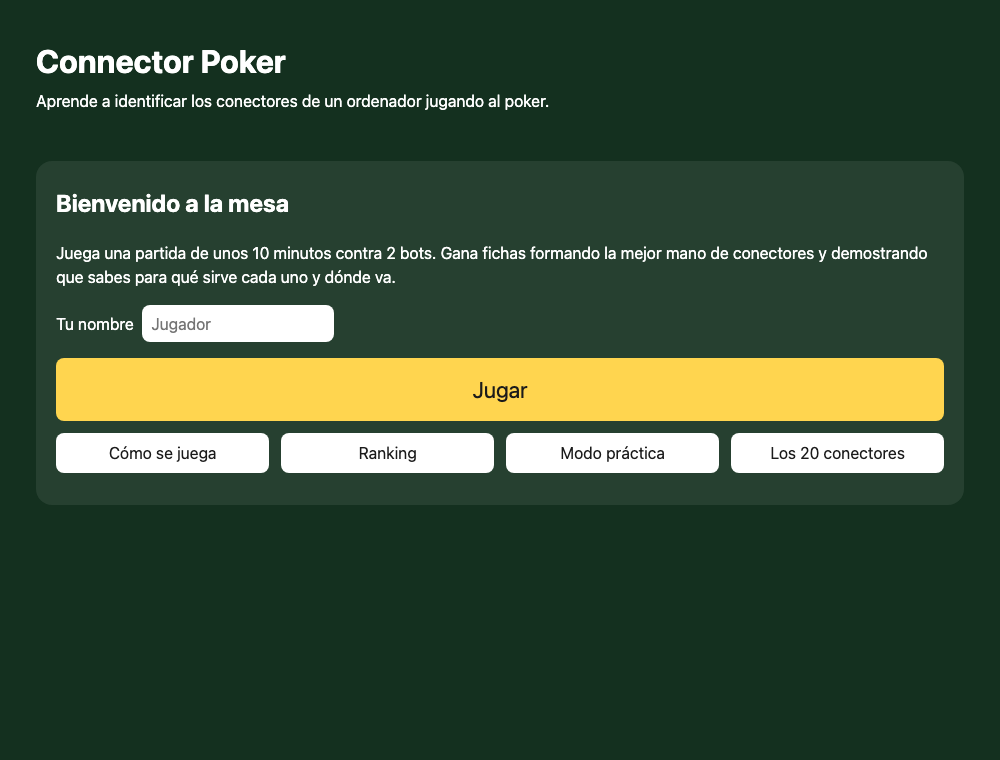
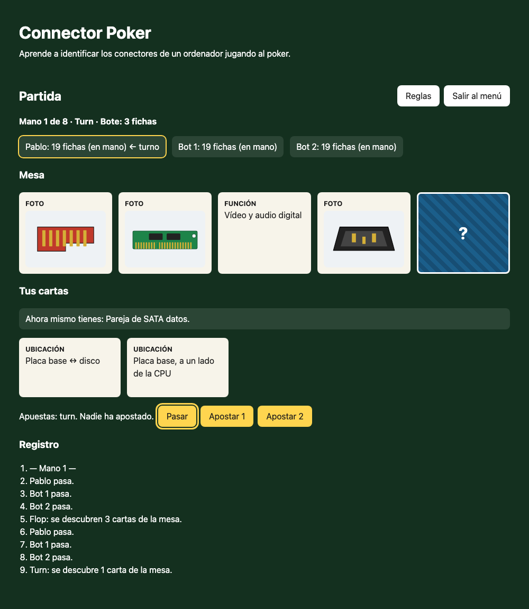
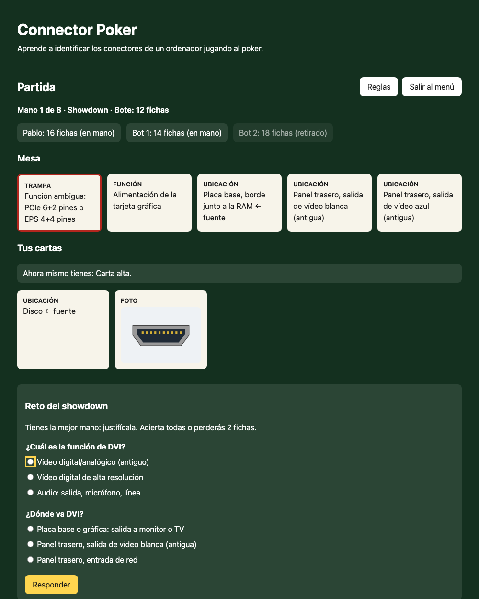
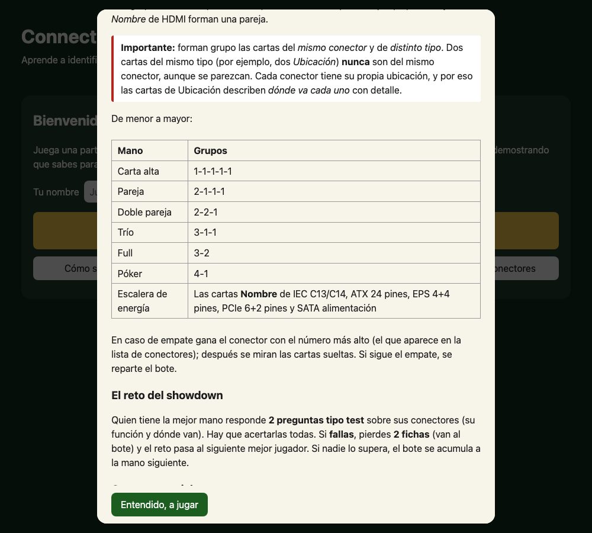
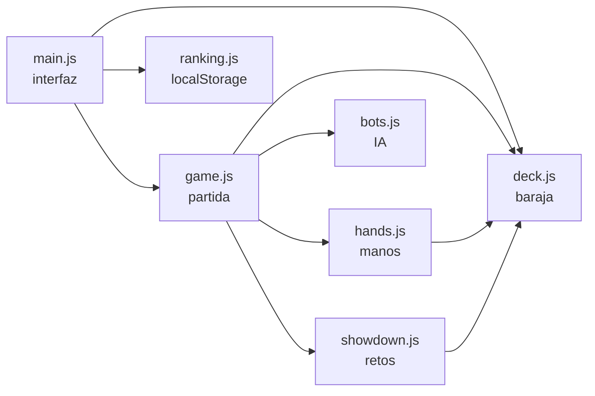
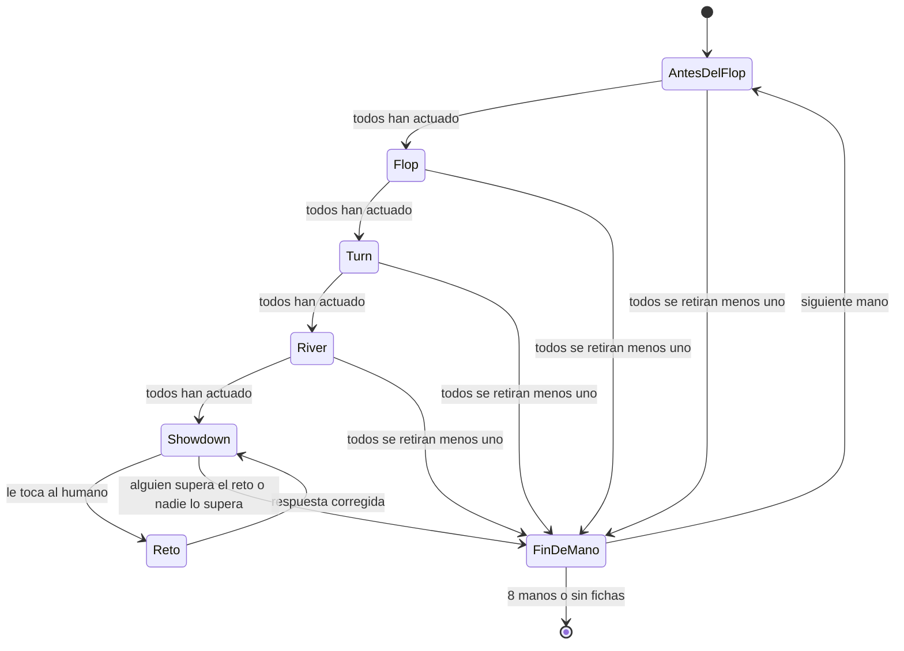

<div align="center">

# 🃏 Connector Poker

**Aprende a reconocer los conectores de un ordenador jugando al poker.**

### [▶ Jugar ahora](https://pablo96sancho.github.io/Juego-Conectores-DAM/)

*HTML + CSS + JavaScript puro · sin frameworks · sin instalar nada*



</div>

---

## ¿Qué es?

**Connector Poker** es un juego educativo para aprender a identificar los **10 conectores internos y los 10 externos** de un ordenador: cómo se llaman, para qué sirven y dónde van. Se juega una partida de unos 10 minutos contra 2 bots, al estilo **Texas Hold'em**.

Es un proyecto en grupo del módulo **Sistemas Informáticos** (DAM, 1.º, IES La Vereda). El enunciado pedía un juego de diseño propio (Kahoot no valía) cuya mecánica obligara a **pensar**, no solo a memorizar nombres.

## ¿Cómo se juega?

Cada conector tiene **4 cartas**: una **Foto**, un **Nombre**, una **Función** y una **Ubicación**. Una mano de poker se forma agrupando cartas *del mismo conector, sea cual sea su tipo*: la foto del HDMI y la función "Vídeo y audio digital" son una pareja, aunque no se parezcan en nada.

### La idea clave: los grupos son por conector

Esto es lo que más cuesta al principio, así que conviene tenerlo claro:

> **Forman grupo las cartas del *mismo conector* y de *distinto tipo*.** Dos cartas del mismo tipo (por ejemplo, dos *Ubicación*) **nunca** son del mismo conector, porque cada conector tiene una sola carta de cada tipo.

| Cartas | ¿Qué forman? | Por qué |
|---|---|---|
| Foto de HDMI + Nombre de HDMI | **Pareja de HDMI** | Mismo conector, tipos distintos |
| Foto de HDMI + Función "Vídeo y audio digital" | **Pareja de HDMI** | Mismo conector, aunque no se parezcan en nada |
| Foto, Nombre y Función de HDMI | **Trío de HDMI** | Tres tipos del mismo conector |
| Las 4 cartas de HDMI | **Póker de HDMI** | El máximo: un conector solo tiene 4 cartas |
| Ubicación de VGA + Ubicación de DVI | *Nada* (dos cartas sueltas) | Mismo tipo: nunca son del mismo conector |
| Nombre de HDMI + Nombre de DisplayPort | *Nada* | Se parecen, pero son conectores distintos |

Por eso el juego enseña: para saber qué cartas combinan tienes que **relacionar la foto, el nombre, la función y la ubicación de cada conector**.

<div align="center">

</div>

**Una mano, paso a paso**

Como en el Texas Hold'em, tienes **2 cartas propias** y hay **5 cartas comunes** en la mesa que se van descubriendo. Tu mano es la **mejor combinación de 5 cartas entre las 7**: una carta de la mesa puede formar pareja con una tuya, y también puede ayudar a tus rivales.

1. Todos pagan 1 ficha de ante y reciben 2 cartas (empiezas con 20 fichas).
2. **Antes del flop:** primera ronda de apuestas, solo con tus 2 cartas.
3. **Flop:** se descubren 3 cartas de la mesa. Otra ronda de apuestas.
4. **Turn:** se descubre la 4.ª carta. Otra ronda.
5. **River:** se descubre la 5.ª carta. Última ronda.
6. **Showdown con reto:** gana la mejor mano, pero antes de cobrar tiene que **demostrar que sabe lo que tiene**.

En cada ronda puedes pasar, apostar (1 o 2 fichas), igualar o retirarte, con una sola subida por jugador y ronda.

### El reto del showdown: la mecánica propia del juego

Aquí está la idea que hace que el juego enseñe en vez de limitarse a repartir cartas. Quien tiene la mejor mano responde preguntas tipo test sobre *sus* conectores:

<div align="center">

</div>

- 2 preguntas (función y ubicación del conector principal). Hay que acertarlas **todas**.
- Los distractores salen de **conectores parecidos** (mismo tipo o misma ubicación), así que no sirve adivinar por descarte.
- Si **fallas**, pierdes 2 fichas (van al bote) y el reto pasa al siguiente mejor jugador. Si nadie lo supera, el bote se acumula.

### Manos (de menor a mayor)

| Mano | Grupos | |
|---|---|---|
| Carta alta | 1-1-1-1-1 | |
| Pareja | 2-1-1-1 | |
| Doble pareja | 2-2-1 | |
| Trío | 3-1-1 | |
| Full | 3-2 | |
| Póker | 4-1 | |
| **Escalera de energía** | Cartas *Nombre* de IEC C13/C14, ATX 24, EPS 4+4, PCIe 6+2 y SATA alimentación | La mano más alta: todo lo que lleva corriente |

### Cartas especiales

| Carta | Qué hace | Qué tienes que saber para usarla |
|---|---|---|
| 🪤 **Trampa** | Cuenta como carta de *Función* de uno de dos conectores parecidos (HDMI/DisplayPort, VGA/DVI, USB-A/USB-C…) | Qué función tiene cada uno: la diferencia entre los dos |
| 🔌 **Comodín USB** | Sustituye a una carta de USB-A o USB-C | La **velocidad** de una versión de USB (2.0 → 480 Mbps … USB4 v2.0 → 80 Gbps) |
| 🔒 **Comodín Anti-error** | Sustituye a una carta de un conector interno | Su **característica anti-error** (muescas, forma de L, clips…) |

Solo cuenta **una** carta especial por mano, y solo si mejora el rango de la mano. Con la **pista en vivo** de la partida siempre sabes qué mano tienes y qué tendrás que justificar.

La partida dura **8 manos** o hasta que alguien se queda sin fichas, y tu resultado se guarda en un **ranking local** del navegador. Son fichas virtuales: no hay dinero real.

<div align="center">

</div>

### Preguntas frecuentes

<details>
<summary><strong>¿Por qué mis dos cartas con el mismo texto no son pareja?</strong></summary>

Porque las parejas se forman por **conector**, no por parecido. Dos cartas del mismo tipo (por ejemplo, dos *Ubicación*) son siempre de conectores distintos, y el juego solo junta cartas de **tipos distintos del mismo conector**. Es lo que te pasa si tienes, por ejemplo, la Ubicación del VGA y la del DVI: las dos hablan del panel trasero, pero no son pareja.
</details>

<details>
<summary><strong>¿Cómo sé de qué conector es una carta de Ubicación o de Función?</strong></summary>

Leyendo el texto con atención: cada función y cada ubicación describe a un solo conector (por ejemplo, "Panel trasero, salida de vídeo azul (antigua)" es el VGA y la blanca es el DVI). Si dudas, consulta la tabla de los 20 conectores.
</details>

<details>
<summary><strong>No uso mi comodín o mi Trampa. ¿Por qué?</strong></summary>

Una carta especial solo cuenta si **sube el rango** de tu mano y si el conector todavía no tiene en tu mano la carta de ese tipo. Además solo cuenta una por mano. La pista de la partida te dice cuándo cuenta alguna.
</details>

<details>
<summary><strong>¿Qué pasa si dos jugadores tienen la misma mano?</strong></summary>

Se desempata por el número del conector (gana el más alto) y luego por las cartas sueltas. Si sigue el empate, cada uno hace su reto y los que lo superan reparten el bote.
</details>

<details>
<summary><strong>¿Qué pasa si fallo el reto?</strong></summary>

Pierdes 2 fichas (van al bote) y el reto pasa al siguiente mejor jugador. Si nadie lo supera, el bote se acumula a la mano siguiente.
</details>

### Glosario

| Palabra | Significa |
|---|---|
| **Ante** | La ficha que todos ponen en el bote al empezar cada mano |
| **Bote** | Las fichas acumuladas que se lleva el ganador |
| **Flop / Turn / River** | Las 3 primeras, la 4.ª y la 5.ª carta de la mesa, que se van descubriendo |
| **Igualar / Subir** | Poner las fichas de la apuesta actual / apostar 1 o 2 más |
| **Retirarse** | Abandonar la mano perdiendo lo que hayas puesto |
| **Showdown** | El momento de enseñar las cartas y comparar manos |
| **Reto** | Las preguntas que debe superar el mejor jugador para cobrar el bote |

## Los 20 conectores

### Internos

| # | Conector | Función | Ubicación | Anti-error |
|---|---|---|---|---|
| 1 | **ATX 24 pines** | Alimentación de la placa base | Placa base, borde junto a la RAM ← fuente | Carcasa asimétrica con clip de bloqueo: solo entra en una posición |
| 2 | **EPS 4+4 pines** | Alimentación de la CPU | Placa base, esquina junto a la CPU ← fuente | Carcasa con formas asimétricas y clip de bloqueo |
| 3 | **PCIe 6+2 pines** | Alimentación de la tarjeta gráfica | Gráfica ← fuente | Carcasa asimétrica con clip; el módulo "+2" se separa para usar 6 pines |
| 4 | **SATA datos** | Datos de discos HDD/SSD | Placa base ↔ disco | Forma de L |
| 5 | **SATA alimentación** | Alimentación de discos | Disco ← fuente | Forma de L (más ancho que el de datos) |
| 6 | **M.2** | SSD NVMe/SATA, tarjetas wifi | Placa base, entre la CPU y la ranura PCIe | Muesca (key B, M o B+M) que limita en qué ranuras entra |
| 7 | **Ranura PCIe x16 / x1** | Tarjetas de expansión | Placa base, parte inferior (ranuras largas) | Muesca a un lado que impide insertar la tarjeta al revés |
| 8 | **Ranura DIMM** | Módulos de memoria RAM | Placa base, a un lado de la CPU | Muesca descentrada y clips laterales; cada generación DDR cambia la posición de la muesca |
| 9 | **Socket CPU** | Procesador | Placa base, centro (bajo el disipador) | Triángulo de alineación en una esquina y muescas asimétricas |
| 10 | **Panel frontal (F_PANEL)** | Botón de encendido, reset, LEDs | Placa base, borde inferior (cables de la caja) | Cabecera con un pin ausente (key) y cables etiquetados con polaridad |

### Externos

| # | Conector | Función | Ubicación | Anti-error |
|---|---|---|---|---|
| 11 | **USB-A (2.0 / 3.x)** | Periféricos y almacenamiento | Panel trasero (varios) y frontal | Rectangular y no reversible: solo entra en una posición |
| 12 | **USB-C** | Datos, vídeo y carga | Panel frontal y trasero (suele haber 1 o 2) | Reversible (simétrico 180°): no necesita orientación |
| 13 | **HDMI** | Vídeo y audio digital | Placa base o gráfica: salida a monitor o TV | Forma de trapecio con dos esquinas achaflanadas |
| 14 | **DisplayPort** | Vídeo digital de alta resolución | Placa base o gráfica: salida a monitor de alta resolución | Una esquina cortada (achaflanada) |
| 15 | **VGA** | Vídeo analógico (antiguo) | Panel trasero, salida de vídeo azul (antigua) | Forma de D con tornillos de sujeción |
| 16 | **DVI** | Vídeo digital/analógico (antiguo) | Panel trasero, salida de vídeo blanca (antigua) | Forma de D con tornillos y pin plano distintivo |
| 17 | **RJ45** | Red Ethernet | Panel trasero, entrada de red | Pestaña de plástico (clip) y forma asimétrica |
| 18 | **Jack 3,5 mm** | Audio: salida, micrófono, línea | Panel trasero (3 jacks de colores) y frontal | Sin muesca: se evita el error con el código de colores (verde salida, rosa micrófono, azul línea) |
| 19 | **PS/2** | Teclado y ratón (antiguo) | Panel trasero, zona de teclado y ratón | Mini-DIN con guía y código de colores (violeta teclado, verde ratón) |
| 20 | **IEC C13/C14** | Alimentación eléctrica de la fuente | Fuente | Forma trapezoidal asimétrica; C13 es la hembra del cable y C14 el macho de la fuente |

Cada conector tiene una **ubicación propia y distinta**, a propósito: así una carta de *Ubicación* te dice dónde va ese conector concreto y no vale para otro.

## ¿Cómo está hecho?

### Stack

- **HTML + CSS + JavaScript puro** con módulos ES. Sin frameworks, sin bundler y sin dependencias.
- Datos en [`data/conectores.json`](data/conectores.json), cargados con `fetch`.
- Tests con el runner nativo de Node (`node --test`).
- Publicado gratis en **GitHub Pages** (rama `main`, carpeta raíz).
- `localStorage` solo para el ranking local.

### Arquitectura

La idea central es separar la **lógica del juego** (pura, sin DOM, testeable) de la **interfaz**:



| Módulo | Qué hace |
|---|---|
| [`deck.js`](js/deck.js) | Construye la baraja de 90 cartas (80 de conector, 6 Trampa, 2 comodines USB, 2 Anti-error), baraja y reparte. |
| [`hands.js`](js/hands.js) | `evaluateHand` calcula el rango, los desempates y qué carta especial cuenta en 5 cartas. `bestHand` encuentra la mejor mano de 5 entre las 7 disponibles. `compareHands` decide quién gana. |
| [`showdown.js`](js/showdown.js) | Genera los retos de 3 opciones (con distractores de conectores parecidos) y los corrige. |
| [`bots.js`](js/bots.js) | IA sencilla: apuestan según el rango de su mejor mano y la ronda (antes del flop casi nunca se retiran) y superan el reto con probabilidad configurable (0,8). |
| [`game.js`](js/game.js) | Máquina de estados de la partida: rondas de apuestas, mesa, showdown, fichas y fin de partida. |
| [`ranking.js`](js/ranking.js) | Ranking de las 10 mejores partidas en `localStorage`. |
| [`main.js`](js/main.js) | Pantallas, eventos y conexión con el DOM. Es la única parte que toca la página. |

Una mano es una máquina de estados:



### Decisiones de diseño que merece la pena contar

- **Lógica pura e inyectable.** `deck.js`, `hands.js`, `showdown.js`, `bots.js` y `game.js` no tocan el DOM, y el azar (`rng`) se pasa como parámetro. Así los tests son deterministas y se pueden simular partidas enteras.
- **La mejor mano de 7 cartas.** `bestHand` prueba las 21 combinaciones de 5 cartas, y `evaluateHand` prueba cada forma legal de usar la Trampa o un comodín. Una carta especial solo se usa si **sube el rango**: no tiene sentido obligar a justificar una carta para ganar un simple desempate. A igualdad, se prefiere la combinación que no la usa.
- **Un grupo nunca pasa de 4 cartas.** Un comodín solo puede ocupar un tipo (Foto, Nombre, Función, Ubicación) que el conector aún no tenga.
- **Apuestas que siempre se pueden igualar.** Ninguna apuesta supera las fichas que le quedan a otro jugador, así que no hacen falta botes laterales.
- **Imágenes propias en SVG.** Las 20 ilustraciones están dibujadas a mano en código, con las formas anti-error reales (la L del SATA, la muesca del M.2, la esquina cortada del DisplayPort…). Pesan pocos KB y no hay problemas de licencia.
- **Accesibilidad básica:** controles con teclado, foco visible, texto alternativo en las imágenes y resumen de reglas en un `<dialog>` nativo.

### Tests

**70 tests** con `node --test` que cubren:

- Los 7 rangos, los desempates, la Trampa y los comodines, y la mejor mano entre 7 cartas.
- La composición de la baraja.
- Las preguntas de los retos y su corrección.
- El motor de la partida: apuestas, rondas de la mesa, retiradas, empates, penalización y bote acumulado.
- El ranking, incluido el caso de que `localStorage` esté bloqueado.
- Una **simulación de 200 partidas completas** que comprueba en cada paso que las fichas se conservan y que ninguna partida se queda atascada.

## Ejecutarlo en local

El juego carga un JSON con `fetch`, así que hay que servirlo (no vale abrir `index.html` directamente):

```bash
python3 -m http.server 8000     # y abre http://localhost:8000
node --test tests/              # ejecutar los tests
```

## Estructura

```
.
├── index.html
├── css/style.css
├── js/
│   ├── main.js        # pantallas y eventos
│   ├── deck.js        # baraja de 90 cartas
│   ├── hands.js       # evaluación de manos
│   ├── game.js        # estado de la partida
│   ├── bots.js        # IA de los bots
│   ├── showdown.js    # retos de justificación
│   └── ranking.js     # ranking local
├── data/conectores.json
├── assets/img/        # 20 ilustraciones SVG + CREDITS.md
├── tests/             # node --test
└── docs/img/          # capturas de este README
```

Cada conector del JSON sigue este modelo:

```json
{
  "id": 4,
  "nombre": "SATA datos",
  "tipo": "interno",
  "funcion": "Datos de discos HDD/SSD",
  "ubicacion": "Placa base ↔ disco",
  "antiError": "Forma de L",
  "imagen": "assets/img/sata-datos.svg"
}
```

El `id` (1-20) sirve también de **prioridad en los desempates**.

## Créditos

- **Imágenes:** ilustraciones vectoriales propias del grupo, publicadas como CC0. Detalle en [`assets/img/CREDITS.md`](assets/img/CREDITS.md).
- **Información técnica:** datos de conectores y velocidades de USB del enunciado del proyecto. Las fuentes concretas se detallan en la memoria.
- **Desarrollo asistido por IA:** el código se ha escrito con ayuda de [Claude Code](https://claude.com/claude-code), una herramienta de IA.

---

<div align="center">

Proyecto del módulo **Sistemas Informáticos** · DAM · IES La Vereda

</div>
